# 一、为什么要学Linux

因为我们要部署服务，Linux系统一直以其稳定性而闻名，它们可以连续运行多年而不发生任何重大问题。事实上，很多Linux用户都从未在自己的环境中遇到过系统崩溃的情况。相对Windows而言，挂起和崩溃完全是一种常态。

Windows由于是商业产品，源代码封闭，我们无法知道微软在里面做了什么手脚。而Linux由于是源代码开放操作系统，不存在这个问题

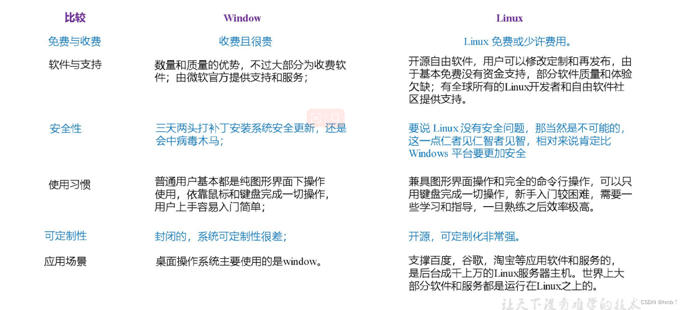

# 二、目录介绍

Linux系统中一切皆文件

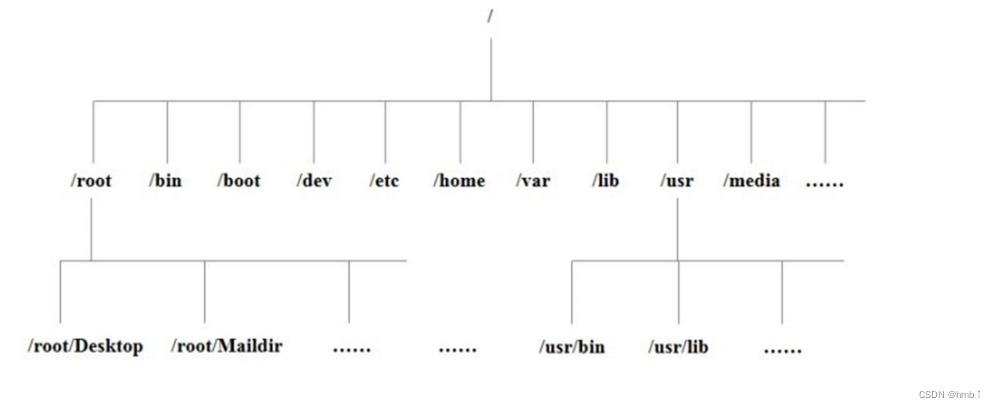

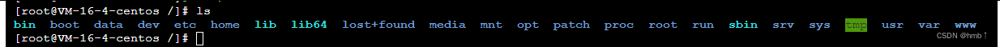

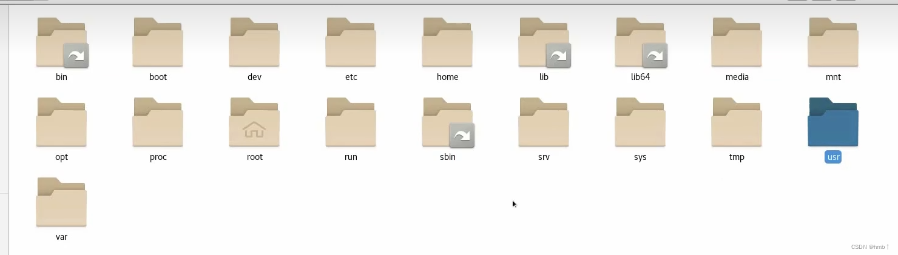

## 核心目录说明

### /bin
- **含义**：binary的缩写
- **作用**：存放最常用的命令
- **特点**：通常链接到 `/usr/bin`，相当于快捷方式

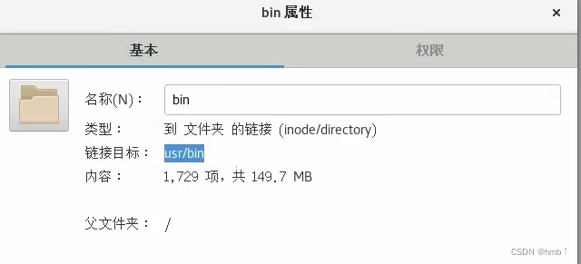

### /sbin
- **含义**：super user binary的缩写
- **作用**：存放系统管理员使用的系统管理程序

### /home
- **作用**：存放普通用户的主目录
- **特点**：每个用户都有自己的目录，通常以用户名命名

### /root
- **作用**：系统管理员（超级权限者）的用户主目录

### /lib
- **作用**：系统启动所需的最基本动态连接共享库
- **类比**：类似Windows中的DLL文件
- **重要性**：几乎所有应用程序都需要用到这些共享库

### /etc
- **作用**：存放系统管理所需的所有配置文件和子目录

### /usr
- **重要性**：非常重要目录
- **内容**：用户的大部分应用程序和文件
- **类比**：类似Windows下的Program Files目录

### /boot
- **作用**：存放启动Linux时使用的核心文件
- **内容**：包括连接文件和镜像文件
- **注意**：不要在此存放个人安装文件

### /proc
- **类型**：虚拟目录
- **原理**：系统内存的映射
- **作用**：通过直接访问此目录可获取系统信息

### /srv
- **含义**：service的缩写
- **作用**：存放服务启动后需要提取的数据

### /sys
- **背景**：Linux 2.6内核的重要变化
- **内容**：安装了2.6内核中新出现的文件系统sysfs

### /tmp
- **作用**：存放临时文件

### /dev
- **类比**：类似Windows的设备管理器
- **作用**：以文件形式存储所有硬件，管理CPU、硬盘等设备

### /media
- **功能**：自动识别设备（如U盘、光驱）
- **机制**：识别后将设备挂载到此目录
- **注意**：CentOS 7已迁移到`/run/media`

### /mnt
- **目的**：供用户临时挂载其他文件系统
- **使用方式**：将外部存储挂载到`/mnt`，进入目录即可查看内容

### /opt
- **用途**：存放额外安装的软件
- **示例**：MySQL数据库可安装在此目录
- **特点**：默认为空

### /var
- **特点**：存放不断扩充的内容
- **习惯**：常存放经常被修改的目录和日志文件

### /lost+found
- **特点**：通常为空
- **用途**：系统非法关机后存放相关文件

### /www
- **用途**：可存储Web应用程序或网站文件
- **性质**：常规目录，可根据需要使用和管理

# 三、vi / vim编辑器

## 基本概念

- **Shell提示符**：`用户@主机名`组成
- **当前目录标识**：`~`号代表当前目录位置
- **用户标识**：`#`号代表管理员用户，`$`号代表普通用户

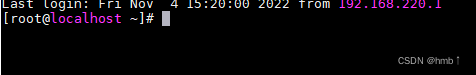

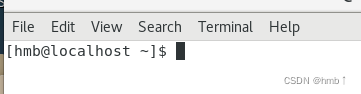

## 编辑器介绍

- **VI**：Unix和类Unix系统中最通用的文本编辑器
- **VIM**：从VI发展而来，性能更强大的文本编辑器
- **特色功能**：可主动以字体颜色辨别语法的正确性，方便程序设计
- **兼容性**：VIM与VI编辑器完全兼容

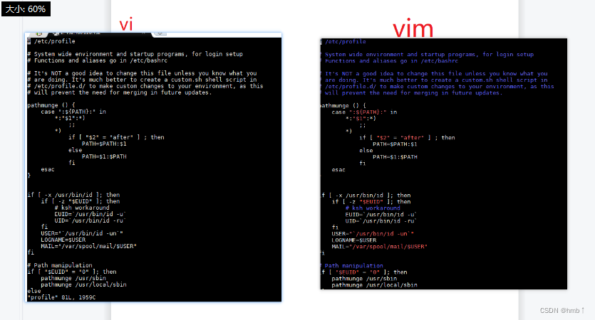

## 模式转换

- **默认模式**：进入后为一般模式
- **编辑模式**：按`i`键进入编辑模式
- **退出编辑模式**：按`Esc`键回到一般模式

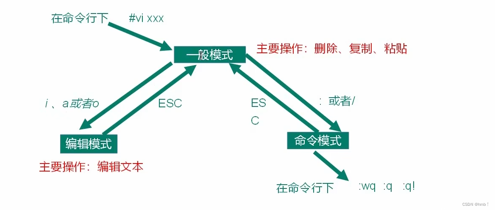

## Vim常用语法

### 一般模式

在一般模式下可以进行以下操作：
- 光标移动
- 复制、粘贴、删除文本
- 搜索替换等操作

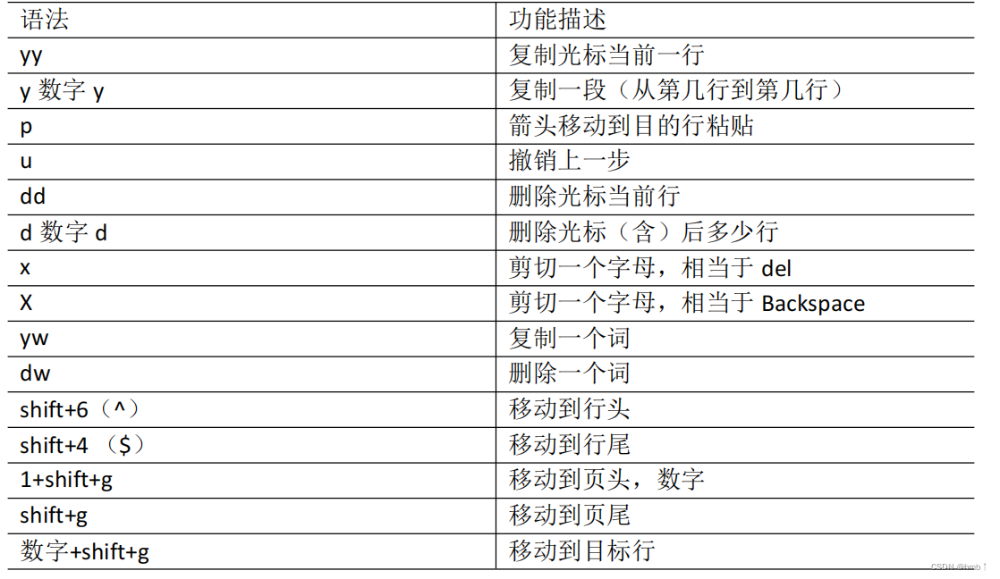

### 编辑模式

在编辑模式下可以：
- 输入和编辑文本内容


### 命令模式

在命令模式下可以：
- 执行保存、退出、查找等命令
- 格式：在一般模式下输入`:`进入命令模式

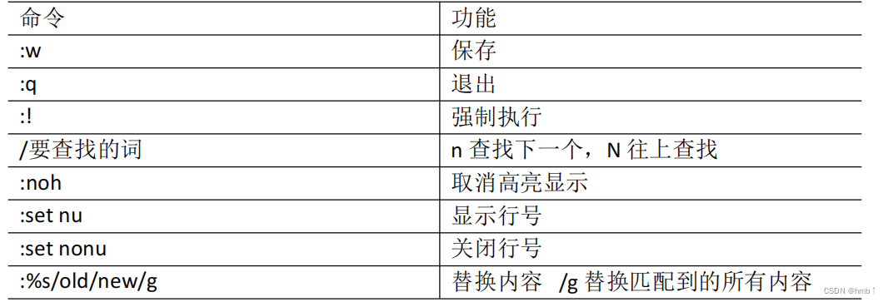

# 四、网络配置

## 4.1 修改 IP 地址

### 编辑网络配置文件

```bash
vim /etc/sysconfig/network-scripts/ifcfg-ens33
```

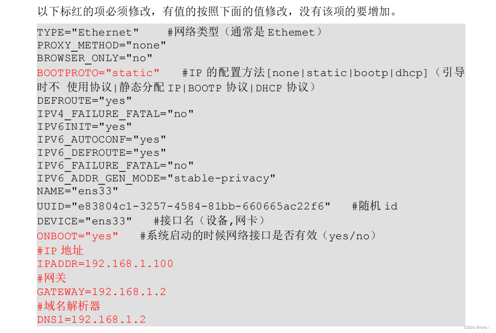

### 重启网络服务

执行以下命令重启网络，使配置生效：

```bash
service network restart
```

## 4.2 配置主机名

### 4.2.1 修改主机名称

#### 1) 查看当前服务器主机名称

```bash
hostname
```

#### 2) 修改主机名

编辑`/etc/hostname`文件修改主机名：

```bash
vim /etc/hostname
```

修改完成后重启系统生效。

### 4.2.2 修改 hosts 映射文件

#### 编辑 hosts 文件

```bash
vim /etc/hosts
```

#### 添加映射

添加映射关系后，保存文件。之后可以直接通过映射名称访问对应的IP地址。

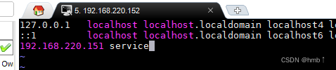

# 五、系统配置

## 5.1 service 服务管理

### 进程与服务概念

- **进程（Process）**：计算机中正在执行的程序或命令
- **服务（Service）**：启动后一直存在、常驻内存的进程

### service 命令语法

```bash
service 服务名 start | stop | restart | status
```

### 查看服务

查看服务的方法：`/etc/init.d/服务名`

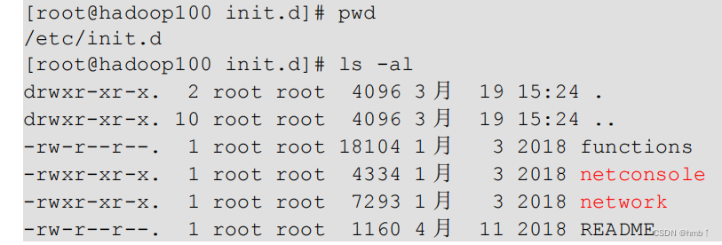

### chkconfig 设置后台服务自启配置

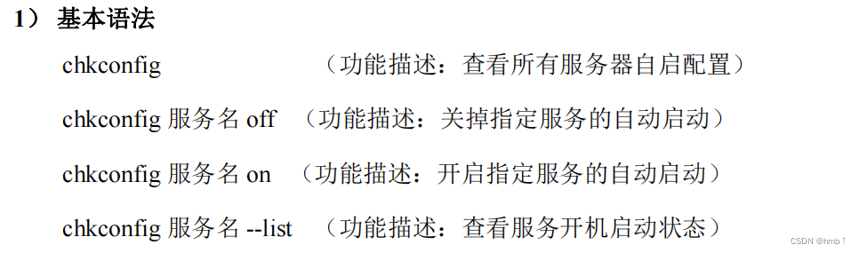

#### 1) 开启/关闭 network(网络)服务的自动启动

```bash
chkconfig network on    # 开启自动启动
chkconfig network off   # 关闭自动启动
```

#### 2) 开启/关闭 network 服务指定级别的自动启动

```bash
chkconfig --level 指定级别 network on
```

## 5.2 systemctl

### 1) 基本语法

```bash
systemctl start | stop | restart | status 服务名
```

### 2) 查看服务的位置

```bash
cd /usr/lib/systemd/system
```

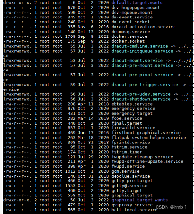

### systemctl 设置后台服务自启配置

#### 1) 查看所有服务开机启动状态

```bash
systemctl list-unit-files
```

#### 2) 关闭指定服务的自动启动

```bash
systemctl disable service_name
```

#### 3) 开启指定服务的自动启动

```bash
systemctl enable service_name
```

## 5.3 防火墙

### 1) 查看、更改防火墙状态

```bash
systemctl status firewalld      # 查看防火墙状态
systemctl stop firewalld         # 关闭防火墙
systemctl start firewalld        # 开启防火墙
systemctl enable firewalld.service   # 开机自启动防火墙
systemctl disable firewalld.service  # 开机不自启动防火墙
```

### 2) 防火墙开放、删除端口

```bash
firewall-cmd --list-ports                    # 查询所有开放的端口
firewall-cmd --query-port=8080/tcp           # 查询端口是否开放
firewall-cmd --add-port=8080/tcp --permanent          # 永久添加8080端口
firewall-cmd --add-port=65001-65010/tcp --permanent  # 永久增加65001-65010端口
firewall-cmd --remove-port=8800/tcp --permanent      # 永久删除8080端口

# 对某个IP开放某个端口
firewall-cmd --permanent --add-rich-rule="rule family='ipv4' source address='192.168.142.166' port port='5432' protocol='tcp' accept"

# 删除对某个IP开放某个端口
firewall-cmd --permanent --remove-rich-rule="rule family='ipv4' source address='192.168.142.166' port port='5432' protocol='tcp' accept"
```

### 命令解读

```bash
firewall-cmd                                    # Linux提供的操作firewall的工具命令
--zone                                          # 作用域
--add-port=8080/tcp                            # 添加端口，格式为：端口/通讯协议；add表示添加，remove则对应移除
--permanent                                     # 永久生效，没有此参数重启后失效
```

### 3) 更新防火墙规则

更改配置后要执行重载配置：

```bash
firewall-cmd --reload
```

## 5.4 关机重启命令

### 0) 数据同步

将数据由内存同步到硬盘中：

```bash
sync
```

### 1) 重启

```bash
reboot           # 重启系统
shutdown -r now  # 立即重启（与reboot作用相同）
```

### 2) 关机

```bash
# 立即关机
shutdown -h now

# 计算机将在1分钟内关机，并且会显示在登录用户的当前屏幕中
shutdown -h 1 'This server will shut down after 1 min'

# 指定时间关机
shutdown 15:28

# 取消关机操作
shutdown -c
```

## 5.5 查看系统内核与版本

### 查看内核/操作系统/CPU信息

```bash
uname -a
```